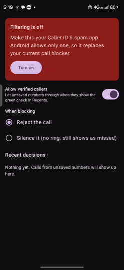

# Verified Call Filter

An Android call-screening app that blocks calls from unsaved numbers, **except** the ones your
carrier has verified.

Blocking every unknown number also blocks legitimate callers such as doctors' offices, delivery
drivers and banks. Those calls usually arrive with a green check in Samsung's Recents, because the
carrier verified the caller number. This app uses that signal to let them through while still
blocking the rest.

<p align="center">
  
</p>

## How it works

Android's `CallScreeningService` is only handed calls from numbers that aren't in your contacts
(as long as the app doesn't hold `READ_CONTACTS`, which this app never requests). For each call it
reads `Call.Details.getCallerNumberVerificationStatus()`, the result of the carrier's
[STIR/SHAKEN](https://en.wikipedia.org/wiki/STIR/SHAKEN) check:

| Status | Result |
| --- | --- |
| `VERIFICATION_STATUS_PASSED` | Allowed (if "Allow verified callers" is on) |
| `VERIFICATION_STATUS_NOT_VERIFIED` | Blocked |
| `VERIFICATION_STATUS_FAILED` (spoofed) | Blocked |

Calls from your saved contacts never reach the app, so they always ring normally.

Blocked calls are either **rejected** or **silenced** (no ring, still logged as missed), your
choice. The app keeps a short on-device list of recent decisions so you can see what it did.

### The green check on Samsung phones

On Samsung phones the green check in Recents is this same STIR/SHAKEN result. Samsung stores it in
its own call-log table (`content://logs/call`, column `sec_stir_shaken`), which is how this was
confirmed.

## Requirements

- Android 11 (API 30) or newer
- A carrier that supports STIR/SHAKEN caller verification (all major US carriers do)

## Setup

1. Build and install the app (see below).
2. Open it and tap **Turn on**, then confirm the system prompt to make it your Caller ID & spam app.

Android allows only one call-screening app at a time, so this replaces any other call blocker you
currently use.

## Building

Open the project in Android Studio, or from the command line:

```sh
./gradlew :app:assembleDebug
./gradlew :app:testDebugUnitTest
```

The debug APK is written to `app/build/outputs/apk/debug/`.

## Limitations

- Not every legitimate caller passes verification. Some small offices and certain call routes arrive
  unverified, and those are blocked.
- Verification is a carrier signal and can vary from call to call for the same number.
- Nothing leaves your device: there is no network access, and the decision log is stored locally.

## License

[MIT](LICENSE)
